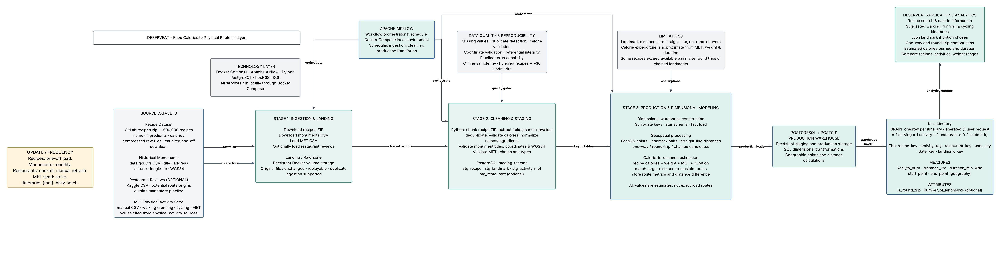
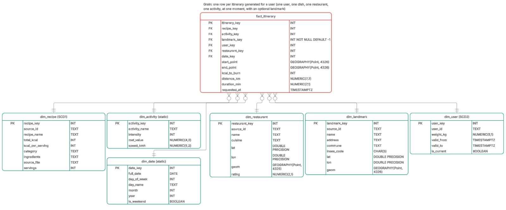

# Deserveat — Food Calories to Physical Routes in Lyon

## 1. Business Brief

### Objective

Deserveat helps people in Lyon translate the calories of a chosen dish into an estimated amount of physical activity by generating a personalised itinerary that includes the selected restaurant and, optionally, a local heritage landmark.

### Data artefact

The main artefact is a PostgreSQL/PostGIS data warehouse organised as a star schema. Its central fact table, `fact_itinerary`, stores one row for each generated itinerary. The fact table is linked to dimensions describing the user, recipe, restaurant, physical activity, date and optional heritage landmark. Recipe calorie data, restaurant information, heritage landmark coordinates and physical-activity MET values are integrated into the warehouse. Synthetic users and itineraries are generated for demonstration purposes.

The estimated activity duration and distance are calculated from the recipe calories per serving, the user's weight, the selected activity's MET value and the activity's estimated speed. These values are estimates for analytical and demonstration purposes; they do not represent measured calories burned, completed exercise or turn-by-turn road routes.

### Stakeholders

- **Primary users:** Students, runners and amateur athletes in Lyon.
- **Secondary users:** Visitors interested in discovering Lyon's heritage through food and outdoor activities.
- **Project team and data engineers:** Responsible for source integration, data quality, orchestration and warehouse maintenance.
- **Potential business partners:** Restaurants and local tourism organisations interested in food-related and active tourism.

### Key performance indicators (KPIs)

| KPI | Definition | Business meaning |
|---|---|---|
| Itinerary generation volume | `COUNT(*)` from `fact_itinerary` | Measures product usage and adoption. |
| Average estimated activity duration | `AVG(duration_min)` | Measures the estimated time commitment associated with users' food choices. |
| Landmark inclusion rate | Percentage of facts with a selected landmark key (excluding the `-1` unknown member) | Measures the use of the heritage-discovery feature. |

These KPIs measure generated itineraries and estimated activity. They do not measure actual calories burned or completed exercise.

### Business questions

1. How many itineraries are generated per day, week and month?
2. Which activities (walking, running or cycling) are selected most frequently?
3. Which recipes have the highest average estimated calorie content per itinerary?
4. What is the average estimated duration required for each activity type?
5. How does estimated activity duration vary across user weight ranges?
6. Which restaurants are associated with the greatest number of generated itineraries?
7. What proportion of itineraries includes a landmark, and which landmarks are selected most often?
8. How does estimated distance vary by activity type and recipe category?

## 2. Datasets

The project uses file-based batch ingestion. Raw files are retained unchanged in a landing layer so that ingestion and transformation can be replayed.

| Dataset | Source and link | Role | Expected size and columns | Refresh |
|---|---|---|---|---|
| Recipes | [Connected Recipe Data Set on GitLab](https://gitlab.com/felix134/connected-recipe-data-set/-/blob/master/data/hummus_data/raw/recipes.zip?ref_type=heads) | Recipe name, ingredients, calories and serving information | Approximately 500,000 recipes. The source contains substantially more than 1,000 rows; the final selected schema contains at least eight useful attributes, including source ID, name, calories, calories per serving, category, ingredients, source file and servings. | One-off download |
| Protected historical monuments | [French open-data dataset on data.gouv.fr](https://www.data.gouv.fr/datasets/immeubles-proteges-au-titre-des-monuments-historiques-2) | Heritage landmark names, addresses and WGS84 coordinates | The source is a large open-government CSV with many columns and more than 1,000 records. The warehouse retains the fields needed for title, address, commune, INSEE code, latitude, longitude and geometry. | Monthly |
| Lyon restaurant reviews | Lyon Restaurant Reviews dataset (Kaggle; project copy/source URL: **[to be completed]**) | Optional restaurant names, cuisines, ratings and coordinates used as route origins | Optional source. The exact file size, column list and access method must be documented when the project copy is added. | One-off download or manual refresh |
| Physical activity MET seed | Manually curated CSV based on the [Compendium of Physical Activities](https://pacompendium.com/) | MET values and estimated speeds for walking, running and cycling | Small reference seed; it is not intended to satisfy the two large-dataset requirement. The final seed schema contains activity name, intensity, MET value and speed. | Static |
| Synthetic users and itineraries | Generated for demonstration purposes | Users and generated itinerary events | **[To be completed: generation method, row count and reproducibility seed]** | Daily batch |

The recipes and monuments datasets are the two primary qualifying datasets for this project. Their exact post-download row counts and the final source-column inventories should be recorded during ingestion validation.

## 3. Tooling and data-engineering lifecycle

| Lifecycle stage | Tools | Purpose |
|---|---|---|
| Source ingestion | Python, `requests`, CSV/ZIP readers | Download the recipe ZIP and monuments CSV, handle chunked reading, and record ingestion metadata. |
| Landing storage | PostgreSQL and Docker volumes | Preserve raw, unchanged files and support replayable ingestion. |
| Cleaning and validation | Apache Airflow tasks, Python and SQL | Select columns, normalise names and ingredients, handle invalid records, validate coordinates, deduplicate data and enforce referential integrity. |
| Staging | PostgreSQL staging schemas | Store typed, cleaned tables before warehouse loading. |
| Production warehouse | PostgreSQL/PostGIS | Build the star schema, surrogate keys, geography columns and analytical measures. |
| Orchestration | Apache Airflow and Docker Compose | Schedule ingestion, quality gates and production transformations. |
| Analytics and reporting | SQL and **[to be completed: dashboard/reporting tool]** | Answer business questions and expose KPIs. |
| Version control and reproducibility | Git, Docker Compose | Version pipeline code and run the local environment consistently. |

## 4. Data Architecture

*Figure 1 — End-to-end architecture. The source, landing, staging, production and analytics layers are shown in [architecture_diagram.jpeg](architecture_diagram.jpeg).*

### Data flow

`Raw sources → Python ingestion → Landing/raw layer → Airflow cleaning and validation → Staging tables → PostgreSQL/PostGIS production star schema → SQL analytics/reporting`

### Ingestion and update strategy

- **Recipes:** file-based batch download of `recipes.zip`; one-off load.
- **Protected monuments:** direct CSV download; monthly refresh.
- **Restaurants:** optional file-based load; one-off or manual refresh.
- **MET reference data:** manually maintained seed CSV; static.
- **Generated itineraries:** daily batch.
- **Landing policy:** original files are preserved unchanged, with ingestion metadata and duplicate-load protection.

### Example data-quality checks

The pipeline should fail its quality gate when a required check fails rather than silently producing a success-shaped result. Examples include:

- **Null check:** recipe name, calories per serving, activity name and itinerary date must not be null.
- **Uniqueness check:** source IDs must be unique within each dimension; `itinerary_key` must be unique in `fact_itinerary`.
- **Range check:** calories, user weight, MET values and estimated speed must be positive.
- **Geospatial check:** monument and restaurant coordinates must be valid WGS84 points within the expected Lyon/French-data coverage.
- **Referential-integrity check:** every fact foreign key must resolve to its corresponding dimension, except the intentional unknown landmark member.

## 5. Data Model

### Grain

The grain of `fact_itinerary` is **one row per itinerary generated for one user, one recipe, one restaurant, one activity, one date and zero or one landmark**.

*Figure 2 — Production star schema. The complete model is shown in [star_schema.jpeg](star_schema.jpeg).*

### Tables

#### Fact table

- **`fact_itinerary`** — One generated itinerary, with foreign keys to the user, recipe, activity, restaurant, date and optional landmark dimensions. It stores estimated calories to burn, distance and duration, as well as route points and request time.

#### Dimension tables and SCD choices

| Dimension | SCD type | Justification |
|---|---|---|
| `dim_recipe` | **Type 1** | Recipe corrections and normalisation should update the current descriptive value. Historical recipe versions are not a business requirement for this demonstration. |
| `dim_activity` | **Static** | Walking, running and cycling are a small controlled reference list whose MET values and speeds are maintained as a curated seed. |
| `dim_date` | **Static** | Calendar attributes are deterministic and do not change. |
| `dim_restaurant` | **Type 1** *(proposed)* | The current restaurant name, cuisine, rating and coordinates are sufficient for the demonstration; historical restaurant changes are not currently required. |
| `dim_landmark` | **Type 1** *(proposed)* | The current official title, address and coordinates are used. A historical preservation-status requirement has not been specified. |
| `dim_user` | **Type 2** | Weight can change over time and affects calorie-burn estimates. Effective timestamps and `is_current` preserve the user context used by each itinerary. |

The diagram currently labels `dim_recipe` as SCD1, `dim_activity` and `dim_date` as static, and `dim_user` as SCD2. Restaurant and landmark SCD choices are documented here as proposed choices because no historical requirements were provided.

## 6. Data Dictionary

## 7. Demo Queries

The following PostgreSQL queries answer the business questions in the brief. They assume the column names in the data dictionary and a populated unknown landmark member.

## 8. Expected Product View

## 9. Limitations and assumptions

- Distances are currently estimated as straight-line or chained distances, not road-network routes.
- Calorie expenditure is estimated from MET, user weight and duration; it is not a physiological measurement.
- Some restaurant data is optional and requires a documented local copy or authenticated Kaggle access.
- The project uses synthetic users and itinerary events for demonstration.

## 10. References and AI disclosure

### Data and methodology references

- [Connected Recipe Data Set](https://gitlab.com/felix134/connected-recipe-data-set/-/blob/master/data/hummus_data/raw/recipes.zip?ref_type=heads)
- [Protected historical monuments dataset — data.gouv.fr](https://www.data.gouv.fr/datasets/immeubles-proteges-au-titre-des-monuments-historiques-2)
- [Compendium of Physical Activities](https://pacompendium.com/)
- Lyon Restaurant Reviews dataset — [restaurants](https://www.kaggle.com/datasets/launay10christian/lyon-restaurant-reviews-dataset)

### AI disclosure

Here are the links to the different AI chats used during this project: 
 - https://claude.ai/share/d6ea6715-199d-4653-8246-9acb3b7d6132

## 11. Group Contribution

- Kawthar AGUIR 36%
- VASQUEZ Juan Martin 31%
- VEGA Josue 33%
