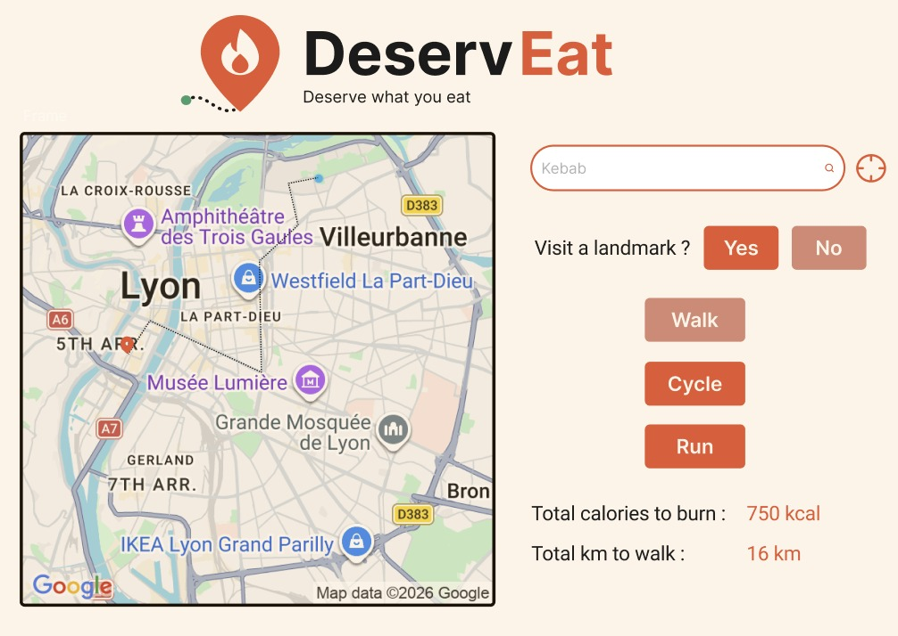

# Deserveat — Food Calories to Physical Routes in Lyon

## 1. Business Brief

### Objective

Deserveat helps people in Lyon translate the calories of a chosen dish into an estimated amount of physical activity by generating a personalised itinerary that includes the selected restaurant and, optionally, a local heritage landmark.

### Data artefact

The main artefact is a PostgreSQL/PostGIS data warehouse organised as a star schema. Its central fact table, `fact_itinerary`, stores one row for each generated itinerary. The fact table is linked to dimensions describing the user, recipe, restaurant, physical activity, date and optional heritage landmark. Recipe calorie data, restaurant information, heritage landmark coordinates and physical-activity MET values are integrated into the warehouse. Synthetic users and itineraries are generated for demonstration purposes.

The estimated activity duration and distance are calculated from the recipe calories per serving, the user's weight, the selected activity's MET value and the activity's estimated speed. These values are estimates for analytical and demonstration purposes; they do not represent measured calories burned, completed exercise or turn-by-turn road routes.

### Stakeholders

- **Primary users:** Students, runners and amateur athletes in Lyon.
- **Secondary users:** Visitors interested in discovering Lyon's heritage through food and outdoor activities.
- **Project team and data engineers:** Responsible for source integration, data quality, orchestration and warehouse maintenance.
- **Potential business partners:** Restaurants and local tourism organisations interested in food-related and active tourism.

### Key performance indicators (KPIs)

| KPI | Definition | Business meaning |
|---|---|---|
| Itinerary generation volume | `COUNT(*)` from `fact_itinerary` | Measures product usage and adoption. |
| Average estimated activity duration | `AVG(duration_min)` | Measures the estimated time commitment associated with users' food choices. |
| Landmark inclusion rate | Percentage of facts with a selected landmark key (excluding the `-1` no landmark member) | Measures the use of the heritage-discovery feature. |

These KPIs measure generated itineraries and estimated activity. They do not measure actual calories burned or completed exercise.

### Business questions

1. How many itineraries are generated per day, week and month?
2. Which activities (walking, running or cycling) are selected most frequently?
3. Which recipes have the highest average estimated calorie content per itinerary?
4. What is the average estimated duration required for each activity type?
5. How does estimated activity duration vary across user weight ranges?
6. Which restaurants are associated with the greatest number of generated itineraries?
7. What proportion of itineraries includes a landmark, and which landmarks are selected most often?
8. How does estimated distance vary by activity type and recipe category?

## 2. Datasets

The project uses file-based batch ingestion. Raw files are retained unchanged in a landing layer so that ingestion and transformation can be replayed.

| Dataset | Source and link | Role | Expected size and columns | Refresh |
|---|---|---|---|---|
| Recipes | [Connected Recipe Data Set on GitLab](https://gitlab.com/felix134/connected-recipe-data-set/-/blob/master/data/hummus_data/raw/recipes.zip?ref_type=heads) | Recipe name, ingredients, calories and serving information | Approximately 500,000 recipes. The source contains substantially more than 1,000 rows; the final selected schema contains at least eight useful attributes, including source ID, name, calories, calories per serving, category, ingredients, source file and servings. | One-off download |
| Protected historical monuments | [French open-data dataset on data.gouv.fr](https://www.data.gouv.fr/datasets/immeubles-proteges-au-titre-des-monuments-historiques-2) | Heritage landmark names, addresses and WGS84 coordinates | The source is a large open-government CSV with many columns and more than 1,000 records. The warehouse retains the fields needed for title, address, commune, INSEE code, latitude, longitude and geometry. | Monthly |
| Lyon restaurant reviews | Lyon Restaurant Reviews dataset (Kaggle; project copy/source URL: **[kaggle]**(https://www.kaggle.com/datasets/launay10christian/lyon-restaurant-reviews-dataset)) | Restaurant names, cuisines, ratings and coordinates used as route origins | Columns: `restaurant_name`, `review_number`, `food_type`, `rankingoverall`, `Rating`, `wifi`, `livraison`, `average_price`, `lat`, `lng`. The warehouse keeps name, cuisine, rating and coordinates. A copy is stored in the repository because Kaggle requires an API key. | One-off download or manual refresh |
| Physical activity MET seed | Manually curated CSV based on the [Compendium of Physical Activities](https://pacompendium.com/) | MET values and estimated speeds for walking, running and cycling | Small reference seed; it is not intended to satisfy the two large-dataset requirement. The final seed schema contains activity name, intensity, MET value and speed. | Static |

The recipes and monuments datasets are the two primary qualifying datasets for this project. Their exact post-download row counts and the final source-column inventories should be recorded during ingestion validation.

The architecture diagram also shows an offline sample of a few hundred recipes and approximately 30 landmarks for reproducibility. The repository currently contains a small illustrative sample (`sql/02_sample_data.sql`) used to test the schema and demo queries.

## 3. Tooling and data-engineering lifecycle

| Lifecycle stage | Tools | Purpose |
|---|---|---|
| Source ingestion | Python, `requests`, CSV/ZIP readers | Download the recipe ZIP and monuments CSV, handle chunked reading, and record ingestion metadata. |
| Landing storage | PostgreSQL and Docker volumes | Preserve raw, unchanged files and support replayable ingestion. |
| Cleaning and validation | Apache Airflow tasks, Python and SQL | Select columns, normalise names and ingredients, handle invalid records, validate coordinates, deduplicate data and enforce referential integrity. |
| Staging | PostgreSQL staging schemas | Store typed, cleaned tables before warehouse loading. |
| Production warehouse | PostgreSQL/PostGIS | Build the star schema, surrogate keys, geography columns and analytical measures. |
| Orchestration | Apache Airflow and Docker Compose | Schedule ingestion, quality gates and production transformations. |
| Analytics and reporting | SQL and Dashboard | Answer business questions and expose KPIs. |
| Version control and reproducibility | Git, Docker Compose | Version pipeline code and run the local environment consistently. |

## 4. Data Architecture


*Figure 1 — End-to-end architecture. The source, landing, staging, production and analytics layers are shown in [architecture_diagram.jpeg](architecture_diagram.jpeg).*

### Data flow

`Raw sources → Python ingestion → Landing/raw layer → Airflow cleaning and validation → Staging tables → PostgreSQL/PostGIS production star schema → SQL analytics/reporting`

### Ingestion and update strategy

- **Recipes:** file-based batch download of `recipes.zip`; one-off load.
- **Protected monuments:** direct CSV download; monthly refresh.
- **Restaurants:** file-based load; one-off or manual refresh.
- **MET reference data:** manually maintained seed CSV; static.
- **Generated itineraries:** daily batch.
- **Landing policy:** original files are preserved unchanged, with ingestion metadata and duplicate-load protection.

### Example data-quality checks

The pipeline should fail its quality gate when a required check fails and report the failure explicitly. Examples include:

- **Null check:** recipe name, calories per serving, activity name and itinerary date must not be null.
- **Uniqueness check:** source IDs must be unique within each dimension; `itinerary_key` must be unique in `fact_itinerary`.
- **Range check:** calories, user weight, MET values and estimated speed must be positive.
- **Geospatial check:** monument and restaurant coordinates must be valid WGS84 points inside the Lyon bounding box (lat 45.55–45.95, lon 4.65–5.15); monuments outside Lyon are filtered out in staging.
- **Referential-integrity check:** every fact foreign key must resolve to its corresponding dimension; itineraries without a landmark point to the `-1` "No landmark" row.

## 5. Data Model

### Grain

The grain of `fact_itinerary` is **one row per itinerary generated for one user, one recipe, one restaurant, one activity, one date and zero or one landmark**.


*Figure 2 — Production star schema. The complete model is shown in [star_schema.jpeg](star_schema.jpeg).*

### Tables

#### Fact table

- **`fact_itinerary`** — One generated itinerary, with foreign keys to the user, recipe, activity, restaurant, date and optional landmark dimensions. It stores estimated calories to burn, distance and duration, as well as route points and request time.

#### Dimension tables and SCD choices

| Dimension | SCD type | Justification |
|---|---|---|
| `dim_recipe` | **Type 1** | Recipe corrections and normalisation should update the current descriptive value. Historical recipe versions are not a business requirement for this demonstration. |
| `dim_activity` | **Static** | Walking, running and cycling are a small controlled reference list whose MET values and speeds are maintained as a curated seed. |
| `dim_date` | **Static** | Calendar attributes are deterministic and do not change. |
| `dim_restaurant` | **Type 1** | The current restaurant name, cuisine, rating and coordinates are sufficient for the demonstration; historical restaurant changes are not currently required. |
| `dim_landmark` | **Type 1** | The current official title, address and coordinates are used. A historical preservation-status requirement has not been specified. |
| `dim_user` | **Type 2** | Weight can change over time and affects calorie-burn estimates. Effective timestamps and `is_current` preserve the user context used by each itinerary. |


## 6. Data Dictionary


Sources: **[R]** Connected Recipe Data Set `recipes.zip` (GitLab) · **[M]** data.gouv.fr Monuments Historiques CSV · **[K]** Kaggle Lyon Restaurant Reviews · **[S]** MET seed CSV (Compendium of Physical Activities) · **[G]** generated / synthetic. 

**fact_itinerary**: one row per itinerary generated [G]
| Column | Type | Description |
|---|---|---|
| itinerary_key | INT | PK |
| recipe_key, activity_key, restaurant_key, user_key, date_key | INT | FKs to dimensions (user = version valid at request time) |
| landmark_key | INT | FK, `-1` = no landmark |
| start_point / end_point | GEOGRAPHY(Point,4326) | Restaurant location / landmark location (restaurant again if no landmark) |
| kcal_to_burn | INT | kcal of one serving |
| duration_min | NUMERIC(7,1) | 60 × kcal / (MET × weight) |
| distance_km | NUMERIC(7,2) | `speed_kmh × duration_min / 60` |
| requested_at | TIMESTAMPTZ | Request timestamp |

**dim_recipe** (SCD1) [R]
| Column | Type | Description |
|---|---|---|
| source_id | TEXT | `recipe_id` |
| recipe_name | TEXT | `title` |
| kcal_per_serving | INT | `calories [cal]` (kcal) |
| servings | INT | `servingsPerRecipe` |
| total_kcal | INT | kcal_per_serving × servings |
| category | TEXT | Derived from `tags` (main, dessert, …) |
| ingredients | TEXT | `ingredient_food_kg_names` |
| source_file | TEXT | Lineage (file of origin) |

**dim_restaurant** (SCD1) [K]
| Column | Type | Description |
|---|---|---|
| source_id | TEXT | md5(name, lat, lng) |
| name | TEXT | `restaurant_name` |
| cuisine | TEXT | `food_type` |
| rating | NUMERIC(2,1) | `Rating` (0–5) |
| lat, lon | DOUBLE PRECISION | `lat`, `lng` (WGS84) |
| geom | GEOGRAPHY(Point,4326) | Built from lat/lon |

**dim_landmark** (SCD1) [M]
| Column | Type | Description |
|---|---|---|
| source_id | TEXT | Mérimée reference |
| name | TEXT | Monument title |
| address, commune | TEXT | Location |
| insee_code | CHAR(5) | Lyon: 69381–69389 |
| lat, lon | DOUBLE PRECISION | WGS84 coordinates |
| geom | GEOGRAPHY(Point,4326) | Built from lat/lon |

**dim_activity** (Static) [S]
| Column | Type | Description |
|---|---|---|
| activity_name | TEXT | walking, running, cycling |
| intensity | INT | 1 low – 3 vigorous |
| met_value | NUMERIC(4,2) | Metabolic equivalent |
| speed_kmh | NUMERIC(5,2) | Assumed average speed |

**dim_user** (SCD2) [G]
| Column | Type | Description |
|---|---|---|
| user_id | TEXT | Business key |
| weight_kg | NUMERIC(5,1) | Weight during validity period |
| valid_from / valid_to | TIMESTAMPTZ | Validity period (`9999-12-31` if current) |
| is_current | BOOLEAN | Latest version |

**dim_date** (Static) [G]
| Column | Type | Description |
|---|---|---|
| date_key | INT | YYYYMMDD |
| full_date | DATE | Calendar date |
| day_of_week / day_name | INT / TEXT | ISO weekday (1 = Mon) / name |
| month, year | INT | Calendar parts |
| is_weekend | BOOLEAN | Sat/Sun |

## 7. Demo Queries
**-- Q1. Usage trends: itineraries per day / week / month**

**-- Q1a. Per day (includes days with zero itineraries in the active period)**
```
SELECT d.full_date,
       d.day_name,
       COUNT(f.itinerary_key) AS itineraries
FROM dim_date d
LEFT JOIN fact_itinerary f USING (date_key)
WHERE d.full_date BETWEEN (SELECT MIN(requested_at)::DATE FROM fact_itinerary)
                      AND (SELECT MAX(requested_at)::DATE FROM fact_itinerary)
GROUP BY d.full_date, d.day_name
ORDER BY d.full_date;
```

**-- Q1b. Per ISO week**
```
SELECT date_trunc('week', d.full_date)::DATE AS week_start,
       COUNT(*)                              AS itineraries
FROM fact_itinerary f
JOIN dim_date d USING (date_key)
GROUP BY week_start
ORDER BY week_start;
```

**-- Q1c. Per month, with weekday vs weekend split**
```
SELECT d.year,
       d.month,
       COUNT(*)                                  AS itineraries,
       COUNT(*) FILTER (WHERE d.is_weekend)      AS weekend_itineraries,
       COUNT(*) FILTER (WHERE NOT d.is_weekend)  AS weekday_itineraries
FROM fact_itinerary f
JOIN dim_date d USING (date_key)
GROUP BY d.year, d.month
ORDER BY d.year, d.month;
```

**-- Q2. Activity preferences: which activities are selected most often?**

```
SELECT a.activity_name,
       COUNT(*)                                              AS itineraries,
       ROUND(100.0 * COUNT(*) / SUM(COUNT(*)) OVER (), 1)    AS pct_of_total
FROM fact_itinerary f
JOIN dim_activity a USING (activity_key)
GROUP BY a.activity_name
ORDER BY itineraries DESC;
```

**-- Q3. Recipe analysis: highest average calorie content per itinerary**

```
SELECT r.recipe_name,
       r.category,
       COUNT(*)                       AS itineraries,
       ROUND(AVG(f.kcal_to_burn), 0)  AS avg_kcal_per_itinerary
FROM fact_itinerary f
JOIN dim_recipe r USING (recipe_key)
GROUP BY r.recipe_key, r.recipe_name, r.category
HAVING COUNT(*) >= 1
ORDER BY avg_kcal_per_itinerary DESC
LIMIT 10;
```

**-- Q4. Activity duration: average estimated time to burn the dish**

```
SELECT a.activity_name,
       a.met_value,
       COUNT(*)                                                         AS itineraries,
       ROUND(AVG(f.duration_min), 1)                                    AS avg_duration_min,
       ROUND(percentile_cont(0.5) WITHIN GROUP (ORDER BY f.duration_min)::NUMERIC, 1) AS median_duration_min
FROM fact_itinerary f
JOIN dim_activity a USING (activity_key)
GROUP BY a.activity_name, a.met_value
ORDER BY avg_duration_min DESC;
```

**-- Q5. User profiles: duration by weight range (and activity) dim_user is SCD Type 2, so weight_kg is the weight AT REQUEST TIME.**

```
WITH bucketed AS (
    SELECT f.duration_min,
           a.activity_name,
           CASE WHEN u.weight_kg < 60 THEN 1
                WHEN u.weight_kg < 75 THEN 2
                WHEN u.weight_kg < 90 THEN 3
                ELSE 4 END                                AS bucket_order,
           CASE WHEN u.weight_kg < 60 THEN '< 60 kg'
                WHEN u.weight_kg < 75 THEN '60-75 kg'
                WHEN u.weight_kg < 90 THEN '75-90 kg'
                ELSE '90+ kg' END                         AS weight_range
    FROM fact_itinerary f
    JOIN dim_user     u USING (user_key)
    JOIN dim_activity a USING (activity_key)
)
SELECT weight_range,
       activity_name,
       COUNT(*)                       AS itineraries,
       ROUND(AVG(duration_min), 1)    AS avg_duration_min
FROM bucketed
GROUP BY bucket_order, weight_range, activity_name
ORDER BY bucket_order, activity_name;
```

**-- Q6. Restaurant popularity: most itineraries generated**
```
SELECT rs.name,
       rs.cuisine,
       rs.rating,
       COUNT(*)                         AS itineraries,
       ROUND(AVG(f.kcal_to_burn), 0)    AS avg_kcal_per_itinerary
FROM fact_itinerary f
JOIN dim_restaurant rs USING (restaurant_key)
GROUP BY rs.restaurant_key, rs.name, rs.cuisine, rs.rating
ORDER BY itineraries DESC, rs.rating DESC
LIMIT 10;
```

**-- Q7. Heritage discovery**

**-- Q7a. Share of itineraries that include a landmark**

```
SELECT COUNT(*)                                           AS total_itineraries,
       COUNT(*) FILTER (WHERE landmark_key <> -1)         AS with_landmark,
       ROUND(100.0 * COUNT(*) FILTER (WHERE landmark_key <> -1)
             / NULLIF(COUNT(*), 0), 1)                    AS landmark_inclusion_rate_pct
FROM fact_itinerary;
```
**-- Q7b. Most selected landmarks**
```

SELECT l.name,
       l.commune,
       COUNT(*) AS itineraries
FROM fact_itinerary f
JOIN dim_landmark l USING (landmark_key)
WHERE l.landmark_key <> -1
GROUP BY l.landmark_key, l.name, l.commune
ORDER BY itineraries DESC
LIMIT 10;
```

**-- Q8. Distance analysis: estimated distance by activity and recipe category**

```
SELECT a.activity_name,
       r.category,
       COUNT(*)                        AS itineraries,
       ROUND(AVG(f.distance_km), 2)    AS avg_distance_km,
       MIN(f.distance_km)              AS min_distance_km,
       MAX(f.distance_km)              AS max_distance_km
FROM fact_itinerary f
JOIN dim_activity a USING (activity_key)
JOIN dim_recipe   r USING (recipe_key)
GROUP BY a.activity_name, r.category
ORDER BY a.activity_name, avg_distance_km DESC;
```

## 8. Expected Product View



## 9. Limitations and assumptions

- Distances are straight-line (PostGIS `ST_Distance`), not road-network routes. Chained landmarks are future work; long targets require several round trips.
- Each itinerary assumes **one serving** of the recipe (`kcal_to_burn = kcal_per_serving`).
- An itinerary without a landmark is a loop starting and ending at the restaurant.
- Calorie expenditure is estimated from MET, user weight and duration; it is not a physiological measurement.
- The project uses synthetic users and itinerary events for demonstration.

## 10. References and AI disclosure

### Data and methodology references

- [Connected Recipe Data Set](https://gitlab.com/felix134/connected-recipe-data-set/-/blob/master/data/hummus_data/raw/recipes.zip?ref_type=heads)
- [Protected historical monuments dataset — data.gouv.fr](https://www.data.gouv.fr/datasets/immeubles-proteges-au-titre-des-monuments-historiques-2)
- [Compendium of Physical Activities](https://pacompendium.com/)
- Lyon Restaurant Reviews dataset — [restaurants](https://www.kaggle.com/datasets/launay10christian/lyon-restaurant-reviews-dataset)

### AI disclosure

Here is the link to the AI chat used during this project:
- https://claude.ai/share/d6ea6715-199d-4653-8246-9acb3b7d6132


## 11. Group Contribution

- AGUIR Kawthar 33%
- VASQUEZ Juan Martin 31%
- VEGA Josue 36%